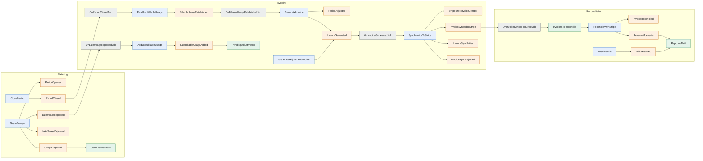

# Event model

Read left to right along time. Blue boxes are commands, orange are events, green are read models, and grey are reactions (jobs). Each subgraph is one namespace under `Billing::`. A namespace appends only to its own streams; it learns other namespaces' facts through reactions (ADR-0010).

## Metering

Stream: `Metering::Period$<customer_id>$<yyyy-mm>`.

| Command | Triggered by | Events | Rejects when |
|---|---|---|---|
| `ReportUsage` | API controller | `PeriodOpened` (first usage only), `UsageReported`, `LateUsageReported`, `LateUsageRejected` | Same key with a different payload (`IdempotencyConflict`), quantity ≤ 0 |
| `ClosePeriod` | Scheduler at `ends_at + grace_seconds` | `PeriodClosed` | Period already closed |

| Event | Data |
|---|---|
| `PeriodOpened` | period_id, customer_id, starts_at, ends_at (half-open, UTC), plan_version, grace_seconds, max_lateness_seconds |
| `UsageReported` | customer_id, idempotency_key, quantity, occurred_at, reported_at, payload_sha |
| `LateUsageReported` | same as `UsageReported`, plus days_late |
| `LateUsageRejected` | customer_id, idempotency_key, quantity, occurred_at, days_late |
| `PeriodClosed` | period_id, customer_id, starts_at, ends_at, plan_version, final_quantity, usage_count, closed_at_version |

Read model: `OpenPeriodTotals` (display only, never billed from).

## Invoicing

Streams: `Invoicing::PeriodBilling$<customer_id>$<yyyy-mm>` and `Invoicing::Invoice$<invoice_id>`.

| Command | Triggered by | Events |
|---|---|---|
| `EstablishBillableUsage` | `OnPeriodClosedJob` | `BillableUsageEstablished` |
| `AddLateBillableUsage` | `OnLateUsageReportedJob` | `LateBillableUsageAdded` |
| `GenerateInvoice` | `OnBillableUsageEstablishedJob` | `PeriodAdjusted` for each prior period with late usage, then `InvoiceGenerated` |
| `GenerateAdjustmentInvoice` | Month-end scheduler | `PeriodAdjusted`, `InvoiceGenerated` |
| `SyncInvoiceToStripe` | `OnInvoiceGeneratedJob` | `StripeDraftInvoiceCreated`, `InvoiceSyncedToStripe`, `InvoiceSyncFailed`, `InvoiceSyncRejected` |

| Event | Data |
|---|---|
| `BillableUsageEstablished` | period_id, customer_id, plan_version, quantity, source_event_id |
| `LateBillableUsageAdded` | period_id, quantity, source_event_id |
| `PeriodAdjusted` | adjustment_id, period_id, billed_quantity, new_quantity, billed_subtotal_cents, new_subtotal_cents, delta_cents, as_of_version |
| `InvoiceGenerated` | invoice_id, customer_id, lines[{line_id, description, quantity, amount_cents, adjusts_period_id}], subtotal_cents, currency |
| `StripeDraftInvoiceCreated` | invoice_id, stripe_invoice_id |
| `InvoiceSyncedToStripe` | invoice_id, stripe_invoice_id, stripe_subtotal_cents, finalized_at |
| `InvoiceSyncFailed` | invoice_id, step, stripe_error_code (transient; the job retries) |
| `InvoiceSyncRejected` | invoice_id, step, stripe_error_code (permanent; needs a person) |

Read model: `PendingAdjustments`.

## Reconciliation

Streams: `Reconciliation::Invoice$<invoice_id>` and `Reconciliation::OrphanStripeInvoice$<stripe_invoice_id>`.

| Command | Triggered by | Events |
|---|---|---|
| `ReconcileWithStripe` | Nightly scheduler, or on demand | `InvoiceReconciled`, or one or more drift events (ADR-0008) |
| `ResolveDrift` | A person, from the drift report | `DriftResolved` |

Read models: `InvoicesToReconcile` (from `InvoiceGenerated` and `InvoiceSyncedToStripe`), `ReportedDrift` (one row per drift, from the drift events and `DriftResolved`).

## Contract

Field lists are the contract for each slice. A slice may add fields; it may not remove or rename one without an ADR.
